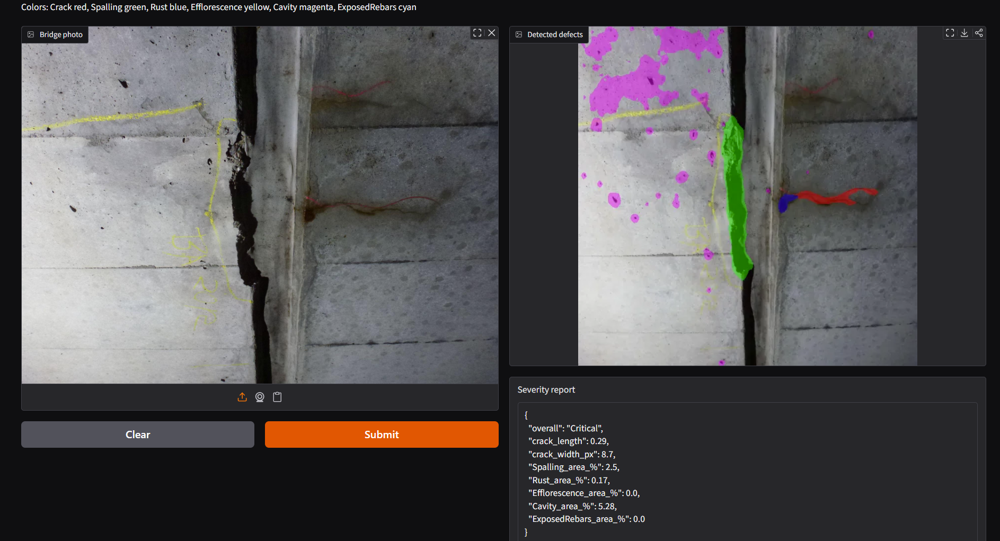
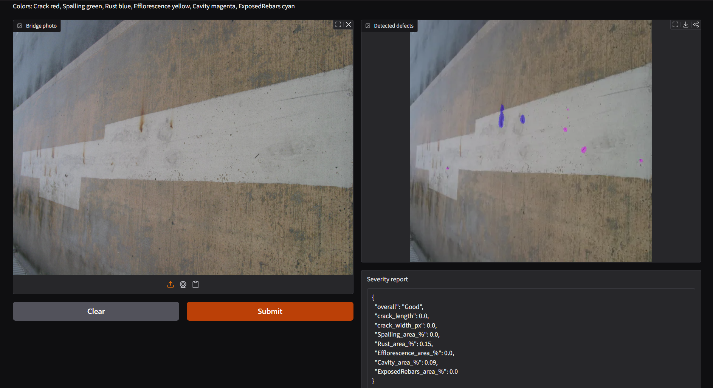
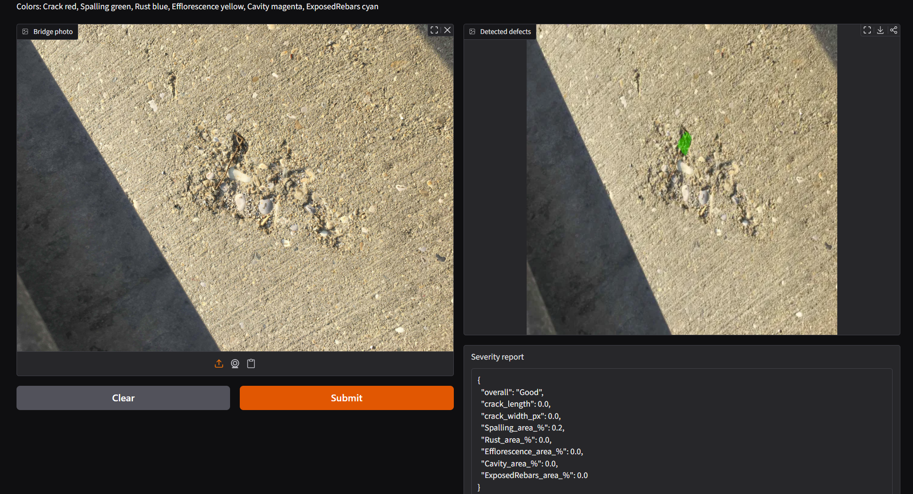
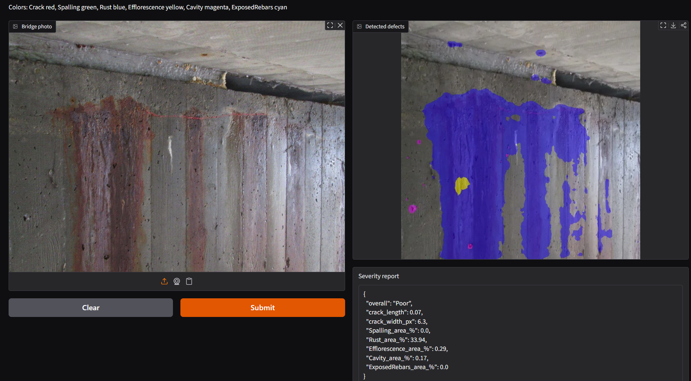

# Automated Bridge Inspection: Multi-Defect Segmentation and Severity Grading

A deep-learning pipeline that finds six kinds of damage in photos of concrete bridges (crack, spalling, rust,
efflorescence, cavity, exposed rebars) and converts the predicted masks into an overall condition grade:
**Good, Fair, Poor or Critical**. Trained on the public [dacl10k](https://github.com/phiyodr/dacl10k-toolkit) dataset.
IDSE course project, Group 22.

> This is an aid to visual inspection, not a replacement for a professional structural assessment.

<p align="center">
   
   
</p>

Full write-up: [report.pdf](report.pdf)

## How it works

1. **Segmentation.** Each photo is resized to 512 x 512 and gets one independent yes/no mask per defect. Defects
   overlap, so this is a multi-label model, not one class per pixel.
2. **Severity grading.** Masks are cleaned of tiny specks, measured (share of the image covered, or crack length and
   width) and turned into a grade with fixed rules. dacl10k has no severity labels, so the rules were checked against
   our own manual ratings.
3. **Demo.** A Gradio web app returns the marked defects and a severity report for an uploaded photo.

## Results

Segmentation, on the official dacl10k validation split used as our test set (975 images):

| Model (ResNet34 encoder) | Val mIoU | Test mIoU |
|---|---|---|
| U-Net (baseline) | 0.326 | 0.300 |
| FPN | 0.339 | 0.306 |
| DeepLabV3+ | 0.333 | 0.301 |
| **Ensemble (FPN + DeepLabV3+, flip averaging)** | 0.355 | **0.320** |

The differences between single models are small and may be within noise. Cavity is the weakest class (IoU 0.169).
More tables are in [`results/`](results/).


Severity grading against human ratings, on 200 held-out images rated by two team members:

| Metric | Rule-based grader |
|---|---|
| Quadratic weighted kappa | 0.51 (95% bootstrap CI 0.37 to 0.62) |
| Exact agreement | 55.0% |
| Within one level | 84.0% |
| Critical images caught | 24 of 37 |

Agreement between human raters was 0.88 on this set, so the grader is clearly below human level. A learned
grader trained on 120 development images was not reliably better (kappa 0.505), so the simple rules were kept.


## Method

- **Models:** U-Net (baseline), FPN and DeepLabV3+, all with an ImageNet-pretrained ResNet34 encoder.
- **Training (same for every model):** BCE + Dice loss, AdamW (lr 3e-4, weight decay 1e-4), cosine schedule,
  30 epochs, batch size 8, 512 x 512 input, mixed precision, seed 42. Best epoch chosen by validation mIoU.
- **Thresholds:** per-class, tuned on the validation set only ([`configs/thresholds_ens_flip.json`](configs/thresholds_ens_flip.json)).
- **Ensemble:** FPN and DeepLabV3+, each averaged with a horizontally flipped copy of the image.
- **Severity rules** ([`configs/severity_rules_final.json`](configs/severity_rules_final.json)):

| Defect | Moderate from | Severe from |
|---|---|---|
| Spalling | 1% of image | 5% |
| Rust | 2% | 8% |
| Efflorescence | 3% | 10% |
| Cavity | 0.5% | 2% |
| Exposed rebars | 0.2% | 1% |
| Crack (skeleton length, in image widths) | 0.3 | 1.0 |

  A defect counts once it reaches 25% of its moderate level, and a crack wider than 6 pixels is raised one level.
  Crack, spalling, cavity and exposed rebars can reach Critical; rust and efflorescence are capped at Poor. The overall
  grade is the highest level among the defects. Widths are in pixels because the photos have no real-world scale.
- **Manual ratings:** raters followed a written four-level guideline (Good, Fair, Poor, Critical) and rated
  independently. The reference grade is the median of the raters' grades, with ties rounded up to the more severe level.

## Repository contents

| Path | What it is |
|---|---|
| `notebooks/` | Colab notebooks: training of the three models, then ensemble, severity grading, human-rating analysis and demo |
| `figures/` | Result figures and demo examples |
| `results/` | Result tables (CSV) |
| `configs/` | Frozen severity rules and tuned thresholds |
| `src/bridge_inspect/` | Severity rules and ensemble inference code |
| `app.py` | Gradio demo |
| `tests/` | Unit tests for the severity rules |
| `report.pdf` | Final project report |

## Running the code

**Notebooks.** Open them in Google Colab with a free T4 GPU, about 3 to 3.5 minutes per training epoch. They expect the
dacl10k images converted to 512 x 512 images with one mask layer per defect, stored in your own Google Drive folders.

**Severity rules (no GPU or weights needed):**

```bash
pip install -r requirements.txt
python tests/test_severity.py
```

**Demo.** Download `best_fpn.pth` and `best_deeplab.pth` from [this Google Drive folder](https://drive.google.com/drive/folders/10kHo2Sl6FXFcBviV0ehYB_B11nA6Xu2u?usp=sharing)
and place both in a folder named `weights/` next to `app.py`, then run:

```bash
python app.py            # add --share for a temporary public link
```

Colours in the output: crack red, spalling green, rust blue, efflorescence yellow, cavity magenta, exposed rebars cyan.

## Data

The dataset is not included. Download dacl10k from the [official repository](https://github.com/phiyodr/dacl10k-toolkit)
(Flotzinger, Rosch and Braml, arXiv:2309.00460). We kept six of its classes and treated the rest as background.

## Limitations

- The official test labels are withheld, so the official validation split is used as the test set. Our own validation
  split comes from the training set, so its scores are optimistic.
- Annotations are coarse, and cavity predictions over-predict (precision 0.21).
- The severity rules are heuristic, measured in pixels, and agree with raters well below human-human level.
- All raters are team members, not professional bridge inspectors, and the final check used two raters.
- The ensemble needs four forward passes per image, so it is slower than a single model.

## Team

- Namitha Sai Kolli - CS24B1016,
- Jeevani Yalamanchili - CS24B1023,
- Gouthami Gogineni - CS24B1041,
- Vishnu Tejaswini Ravipati - CS24B1064
